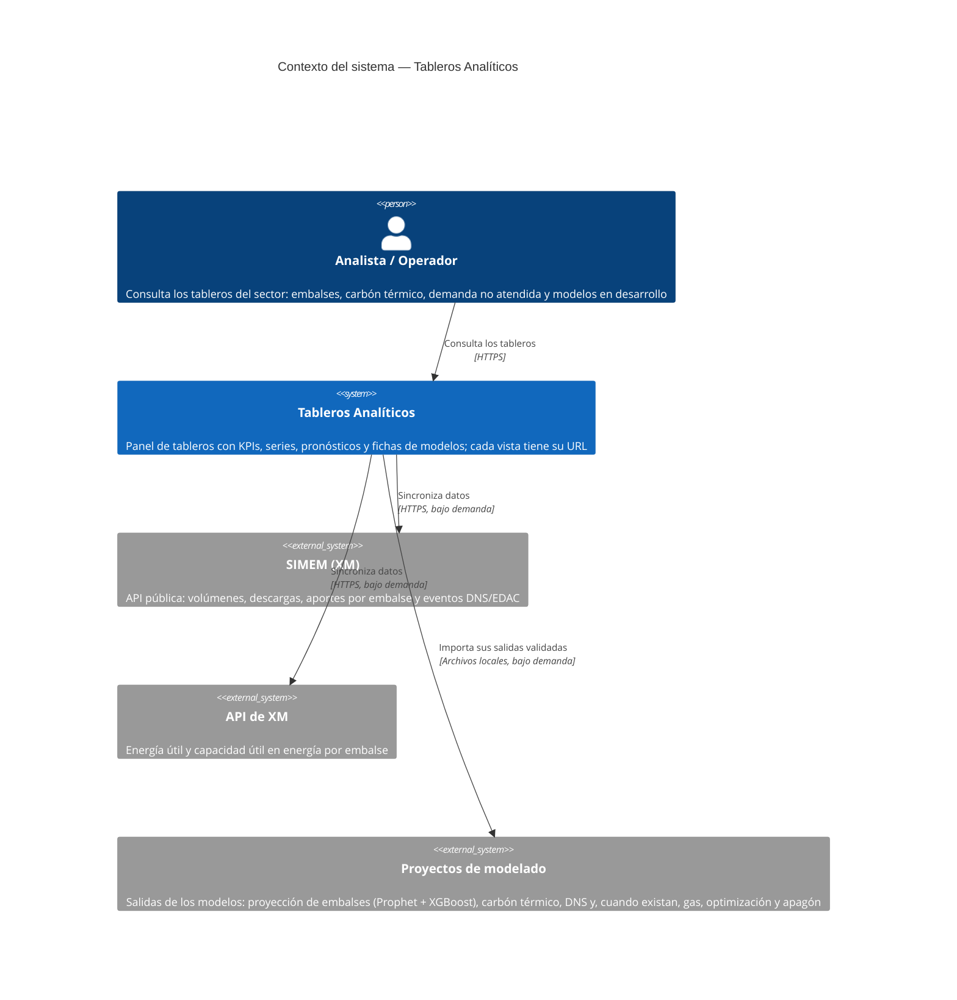
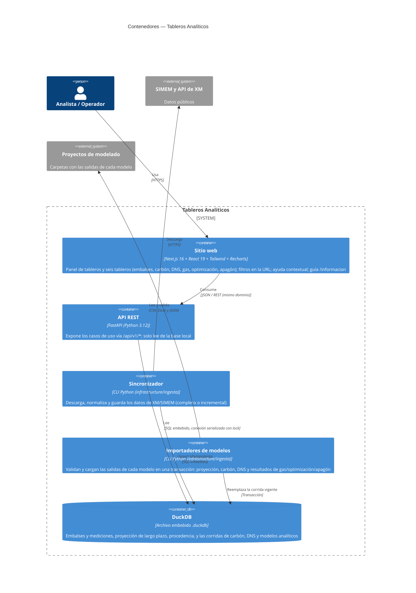
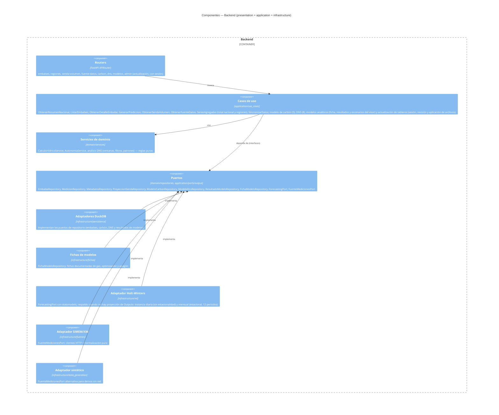

# Tableros Analíticos

[](https://github.com/alerogoz85/plataforma-embalses/actions/workflows/ci.yml)

**Tableros Analíticos** es la plataforma del Ministerio de Minas y Energía que reúne en un solo lugar los tableros de seguimiento
del sector. El primero, y el más completo, es el de monitoreo hidrológico con **datos reales y públicos de XM/SIMEM**
(Colombia): volumen y energía útiles, aportes, descargas, pronóstico diario de
%V. útil y una senda mensual de largo plazo, ambos a 1, 3, 6 y 12 meses, con
la proyección del modelo de largo plazo (Prophet + XGBoost, escenarios ENSO).
Backend con arquitectura hexagonal y dashboard Next.js con ayuda contextual (ⓘ)
en cada encabezado técnico.

La página principal (`/`) es **Tableros Analíticos**, un panel de acceso a tableros, todos con la misma estructura
(encabezado, filtros globales, tarjetas, gráficos), arquitectura y seguridad: **Embalses**
(`/embalses`), **Carbón térmico** (`/carbon`), **Demanda no atendida** (`/dns`) y, para los modelos
que aún no entregan resultados finales, **Gas natural** (`/gas`), **Optimización hidrotérmica**
(`/optimizacion`) y **Riesgo de apagón** (`/apagon`). Ver [Tableros y modelos](#tableros-y-modelos).

**Guía técnica y manual de usuario:** botón «Información» del encabezado, o directamente
[tableros-analiticos.vercel.app/informacion](https://tableros-analiticos.vercel.app/informacion)
(cargue e integración de datos con diagramas y periodicidad, cálculos, API, plataformas
y un manual con capturas de cada tablero).

> **Los datos son reales**, descargados de SIMEM y de la API de XM con un
> comando de sincronización, y se guardan en una base DuckDB local (la API no
> llama a servicios externos en cada consulta). El pie del dashboard muestra
> la procedencia y la fecha de corte. Las **proyecciones** no vienen de XM: son la
> salida del modelo de largo plazo del proyecto `1. Modelo niveles de embalses`
> (importada a la base), con un respaldo estadístico propio (Holt-Winters) solo
> para Agregado Bogotá; no son proyecciones oficiales. Los tableros de carbón, demanda
> no atendida, gas, optimización y apagón muestran la salida de **sus propios modelos**
> (se importan de cada proyecto; ver [Tableros y modelos](#tableros-y-modelos)). Los límites
> de todo esto están en [Alcance y límites](#alcance-y-límites). Existe una fuente
> sintética opcional para demostraciones sin red; si se usa, el dashboard lo
> declara ("Datos no reales").

## Índice

- [Arquitectura](#arquitectura)
- [Diagramas C4](#diagramas-c4)
- [Datos y fuentes](#datos-y-fuentes)
- [Modelo de cálculo hídrico](#modelo-de-cálculo-hídrico)
- [Alcance y límites](#alcance-y-límites)
- [Tableros y modelos](#tableros-y-modelos)
- [Módulo de actualización de tableros](#módulo-de-actualización-de-tableros)
- [Estructura del repositorio](#estructura-del-repositorio)
- [Cómo ejecutar el proyecto](#cómo-ejecutar-el-proyecto)
- [Despliegue en Vercel](#despliegue-en-vercel)
- [Referencia de la API](#referencia-de-la-api)
- [Pruebas](#pruebas)
- [Decisiones de diseño](#decisiones-de-diseño)

## Arquitectura

El backend sigue **Arquitectura Hexagonal (Puertos y Adaptadores)** con cuatro
capas estrictamente desacopladas:

| Capa | Responsabilidad | Depende de |
|---|---|---|
| `domain/` | Entidades, value objects y servicios de cálculo hídrico puros. Sin dependencias externas. | Nada |
| `application/` | Casos de uso, DTOs (Pydantic) y puertos (interfaces) de entrada/salida. | `domain/` |
| `infrastructure/` | Adaptadores concretos: DuckDB, fuentes de datos (SIMEM/XM, sintética), pronóstico Holt-Winters. | `domain/`, `application/` |
| `presentation/` | API REST (FastAPI): routers, DTOs de transporte, manejo de errores. | `application/` |

La regla de dependencia siempre apunta hacia adentro: `domain` no importa
nada de `application` ni `infrastructure`; `application` sólo conoce
interfaces (`domain.repositories.*`, `application.ports.output.*`), nunca
implementaciones concretas. El *composition root* —el único lugar donde se
conectan interfaces con implementaciones— es
[`presentation/api/dependencies.py`](backend/presentation/api/dependencies.py)
para la API y [`infrastructure/ingesta/sincronizar.py`](backend/infrastructure/ingesta/sincronizar.py)
para la sincronización.

Esto permitió conectar datos reales sin tocar los casos de uso de consulta: la
fuente es un puerto (`FuenteMedicionesPort`) con dos adaptadores intercambiables
(SIMEM/XM y sintética), y sustituir DuckDB por PostgreSQL o Holt-Winters por
Prophet/XGBoost solo requiere implementar `EmbalseRepository`/`MedicionRepository`
o `ForecastingPort`.

## Diagramas C4

### Nivel 1 — Contexto



### Nivel 2 — Contenedores



### Nivel 3 — Componentes del backend



## Datos y fuentes

| Fuente | Dataset / métrica | Qué aporta |
|---|---|---|
| SIMEM | `138ED1` | Capacidad útil y volumen útil diario por embalse (m³), región hidrológica |
| SIMEM | `1445AC` | Descargas por embalse (turbinada, no turbinada, vertimiento; m³/día) |
| SIMEM | `02B289` | Aportes por serie hidrológica de río (m³/s) y su media histórica |
| XM | `VoluUtilDiarEner` | Energía útil almacenada por embalse (kWh → GWh) |
| XM | `CapaUtilDiarEner` | Capacidad útil en energía por embalse (kWh → GWh); es el peso de agregación |
| Modelo de largo plazo | `proyeccion_montecarlo_enso <fecha>.xlsx` (Outputs) | Proyección a 12 meses por embalse y `TOTAL`: P10/P50/P90 (Prophet + XGBoost con escenarios ENSO); se importa a mano, no viene de XM |

- **Embalses:** los 23 embalses individuales que publica XM más el **agregado
  Bogotá** (XM lo publica como una sola entidad y entra al total nacional; su
  código cambió de `AGREGADO_BOGOTA` a `AGREGADO` en enero de 2025 y aquí se
  unifica). El agregado nacional oficial `AGREGADO_SIN` no es un embalse: se usa
  solo como referencia de validación.
- **Aportes:** SIMEM publica aportes por serie de río, no por embalse. El
  mapeo río → embalse
  ([`SERIE_A_EMBALSE`](backend/infrastructure/fuentes/simem_xm_fuente.py))
  viene del proyecto de modelado previo (`1. Modelo niveles de embalses`),
  con los códigos vigentes y los que XM renombró. Varias series de un mismo
  embalse se suman. **Muna y el agregado Bogotá no tienen serie de aportes.**
- **Lo que no se publica no se inventa:** no hay cota, potencia instalada,
  evaporación ni generación por embalse en estas fuentes, así que la plataforma
  ya no las muestra. Cuando un dato falta un día (o para un embalse), queda
  `None` y la interfaz muestra "—", nunca un cero.
- **Validado contra XM:** el %V. útil nacional calculado aquí coincide
  exactamente con el agregado oficial en las últimas fechas (p. ej. 78.12,
  77.86 y 77.52 en 2026-09-20/21/22). Sobre 1.118 días comparables el error
  absoluto medio es 0.04 p.p. (8 días superan 0.3 p.p., por vacíos de la
  fuente).

## Modelo de cálculo hídrico

Implementado como funciones puras en
[`domain/services/calculo_hidrico_service.py`](backend/domain/services/calculo_hidrico_service.py)
y
[`domain/services/autonomia_service.py`](backend/domain/services/autonomia_service.py):

- **% Volumen útil** = `volumen útil del día / capacidad útil del día × 100`,
  con la capacidad que XM publica *ese día*, porque XM la revisa con el tiempo.
  No se acota en 100%: XM publica valores mayores cuando un embalse supera su
  capacidad nominal (p. ej. Playas).
- **Clasificación de riesgo** (5 niveles, la misma para embalses, regiones y sistema;
  [`Porcentaje.nivel_riesgo`](backend/domain/value_objects/porcentaje.py)):

  | Nivel | %V. útil | Código de la API | Color |
  |---|---|---|---|
  | Normal | > 80 % | `NORMAL` | verde |
  | Estable | 70 % a 80 % (80 incluido) | `ESTABLE` | cian |
  | Alerta temprana | 60 % a < 70 % | `ALERTA_TEMPRANA` | ámbar |
  | Situación delicada | 50 % a < 60 % | `SITUACION_DELICADA` | naranja |
  | Crítico | < 50 % | `CRITICO` | rojo |

  Sustituye a la escala anterior (Óptimo/Alerta/Crítico/Reboce con umbrales 30/15/95 %).
  La senda de largo plazo conserva su propio semáforo sobre el mínimo proyectado
  (rojo <55 %, ámbar <65 %, verde ≥65 %).
- **Agregación nacional/regional**: promedio del %V. útil ponderado por la
  **capacidad útil en energía (GWh)** de cada embalse ese día, la convención de
  la métrica oficial de XM «% Volumen Útil Diario (GWh)». Se usa en los KPIs,
  la distribución regional y la serie "Total nacional" de la senda. Si XM no
  publica la capacidad de un embalse un día, el *peso* usa la última capacidad
  publicada más cercana (cambia muy poco) y la energía almacenada queda `None`;
  con esto el error medio frente a XM bajó de 0.50 a 0.04 p.p.
- **Aportes % de la media**: total de aportes ÷ total de la media histórica,
  solo entre los embalses que publican ambos (no un promedio de porcentajes).
- **Capacidad guardada (GWh)**: suma de la energía útil publicada por XM.
- **Días de autonomía**: `volumen útil / (turbinado + vertimientos − aportes)`.
  Es una **estimación aproximada**: no incluye evaporación (no publicada) ni
  entradas distintas al río asociado, por lo que en embalses de una cadena
  (p. ej. Punchiná, que recibe agua turbinada aguas arriba) puede ser
  engañosamente baja. Es `None` si falta algún dato o si los aportes superan las
  salidas.
- **Pronóstico diario (1, 3, 6 y 12 meses = 30, 90, 180 y 360 días)**: es la
  **misma proyección de Outputs que la senda**, para que ambos tableros cuenten la
  misma historia: sus valores mensuales (promedio del mes, situado a mitad de mes)
  se unen por **interpolación lineal** desde el último dato observado
  ([`ProyeccionDiariaService`](backend/domain/services/proyeccion_diaria_service.py)).
  La banda son los escenarios P10–P90, sin incertidumbre en el primer día, y la curva
  llega hasta donde publica el modelo (mediados de septiembre de 2027: con el
  último dato del 25-oct-2026 son ~325 días, y la cifra baja a medida que avanza el corte hasta que se importe
  una corrida nueva). Para un embalse o agregado sin proyección publicada (Agregado
  Bogotá y los agregados regionales), o con una ya vencida, se usa el respaldo Holt-Winters con tendencia amortiguada
  (`statsmodels`), sin estacionalidad, con intervalo de confianza al 95% por
  simulación Monte Carlo (300 trayectorias). La respuesta indica cuál se usó
  (`origen`; `nivel_confianza` es `null` con Outputs).
- **Senda mensual**: el histórico es la serie diaria agregada a promedios
  mensuales. La **proyección es la del modelo de largo plazo de
  `1. Modelo niveles de embalses` (Prophet + XGBoost con escenarios climáticos
  ENSO simulados por Monte Carlo)**: valor central = P50 y banda = escenarios
  P10–P90, hasta 12 meses (si una corrida publicara menos de los pedidos, se muestran
  los publicados y se avisa). Se importa
  desde `Datos/Outputs/proyeccion_montecarlo_enso <fecha>.xlsx` a la tabla
  `proyecciones_senda` (ver «Proyección de largo plazo» más abajo). Para un embalse
  sin proyección publicada (Agregado Bogotá) se usa un **respaldo Holt-Winters
  estacional** (12 periodos, con fallback a no estacional con menos de 24 meses),
  que sí se valida con un backtest walk-forward de los últimos 6 meses (MAE y R²)
  contra persistencia. La respuesta indica cuál se usó (`origen_proyeccion`).
  Semáforo del mínimo proyectado: rojo <55%, ámbar <65%, verde ≥65%.

## Alcance y límites

- El **pronóstico diario** es la proyección de Outputs interpolada linealmente entre
  valores mensuales: la forma dentro de cada mes es una suavización, no un
  resultado del modelo. Agregado Bogotá y los agregados regionales («Todos los
  embalses» de una región) usan el respaldo estadístico (Holt-Winters), que solo ve la serie histórica: sin clima, demanda ni operación
  futura, y que no debe leerse como una predicción puntual.
- La **senda de largo plazo** usa la proyección del modelo Prophet + XGBoost con
  escenarios ENSO (importada de sus Outputs). Cubre 12 meses, su banda son
  escenarios P10–P90 (no un intervalo de confianza; en los primeros meses puede
  ser casi nula) y los archivos entregados no traen validación fuera de muestra.
  Agregado Bogotá no tiene proyección publicada y usa un respaldo Holt-Winters
  (solo serie histórica, con su tabla de validación).
- XM **revisa datos recientes**: cada sincronización incremental vuelve a
  descargar los últimos 7 días para recoger esas correcciones.
- Hay huecos de energía publicada para algunos embalses y periodos (p.
  ej. Miraflores entre abr-2024 y abr-2025); se conservan los volúmenes reales y
  se documenta la imputación del peso (arriba).
- El historial cargado por defecto empieza el 2022-01-01
  (`--desde` lo cambia); los embalses que entraron después (p. ej. Ituango,
  desde dic-2022) tienen menos historia.
- La API solo lee de la base local: para tener datos al día hay que ejecutar la
  sincronización.
- **Carbón y DNS** muestran la corrida vigente de su modelo (carbón: proyección oct-2026 a jun-2027 con escenarios P10-P90, que no son
  intervalos de confianza; DNS: eventos hasta el último reportado, con el mes del corte parcial). Se actualizan importando una corrida nueva.
- **DNS**: los eventos EDAC se cuentan aparte (su valor es carga desconectada, no kWh); los patrones por hora excluyen la «hora desconocida»;
  parte de las causas se infiere del texto; el aumento de eventos de 2024-2025 viene en parte de cambios en la forma de reportar.
- **Gas y apagón ya tienen resultados reales; optimización aún no**: los lectores de gas (`Resultados/pronostico_v2/Pronostico_Gas_v2.xlsx`, con
  DCA y backtesting opcionales) y de apagón (`Resultados/resultados_modelo_riesgo_apagon/`) se validaron con los archivos reales. La carpeta de
  optimización sigue vacía y su corrida es una prueba técnica no publicable, así que su tablero muestra la ficha y cómo cargar resultados.

## Tableros y modelos

### Panel y rutas

| Ruta | Qué es |
|---|---|
| `/` | Panel principal: una tarjeta de acceso por tablero (las de modelos sin resultados finales llevan la marca «En desarrollo») |
| `/embalses` | Tablero de monitoreo de embalses |
| `/carbon` | Tablero del modelo de carbón térmico |
| `/dns` | Tablero de demanda no atendida (DNS) |
| `/gas`, `/optimizacion` | Tableros de los modelos de gas y optimización hidrotérmica (ficha + resultados importables) |
| `/actualizar` | **Módulo de actualización de tableros** (acceso con cuenta; ver [Módulo de actualización](#módulo-de-actualización-de-tableros)) |
| `/apagon` | **Gemelo digital de riesgo de apagón**: visor interactivo con menú izquierdo (modo de ONI, ONI, simulaciones, horizonte); sin escenarios importados queda la ficha |
| `/informacion` | Guía técnica y manual de usuario (página estática) |

Los tableros se registran en [`frontend/lib/tableros.ts`](frontend/lib/tableros.ts); el panel
se dibuja a partir de esa lista, así que **agregar un tablero nuevo = una entrada en el registro
+ una carpeta en `app/`**. Todos comparten `Header` (con el enlace «Tableros» de vuelta al panel),
`Footer`, `Card`, `KpiCard`, `Campo` (filtro con ⓘ) y los tokens de la identidad GOV.CO.

### Rutas y direcciones (URL)

[`frontend/lib/rutas.ts`](frontend/lib/rutas.ts) es el **manejador central de rutas**: la única fuente de las direcciones (rutas de cada tablero,
capítulos de la guía, alias y construcción de URLs con parámetros). El panel, el encabezado, `next.config.ts` y las pruebas salen de ahí; nadie
escribe una ruta a mano. **Cada vista y cada filtro tienen su dirección**: el estado se guarda en la URL con el hook
[`useEstadoUrl`](frontend/lib/hooks/useEstadoUrl.ts), así que un enlace reproduce la vista exacta, recargar no la pierde y «atrás» funciona.

| Ruta | Parámetros (lo que vale el defecto no aparece) |
|---|---|
| `/embalses` | `region`, `embalse`, `desde`, `hasta` (AAAA-MM-DD), `h` (30, 90, 180, 360 días), `hs` (1, 3, 6, 12 meses), `q`, `orden`, `dir` |
| `/carbon` | `historia` (12, 36, 60, 0), `horizonte` (1, 3, 6, 9), `unidad` (gbtu, kt), `dias` (15, 30, 45, 60) |
| `/dns` | `periodo` (12, 36, 60, 0), `region`, `subarea`, `origen` (programada, no_programada), `medida` (eventos, energia), `ampliar` (zonas, modelo) |
| `/gas`, `/optimizacion` | `desde`, `hasta` (AAAA-MM) y los filtros del modelo (gas: `serie`, `variable`) |
| `/apagon` | `modo` (`manual`\|`probabilistico`), `oni` (−2,5 a 2,5 de 0,1 en 0,1), `simulaciones` (1000\|2000\|5000), `horizonte` (12\|18\|24) |

- **Validación:** cada parámetro se lee contra la misma lista cerrada que acepta la API (`lib/utils/url.ts`); uno inválido se ignora y queda el defecto, así una
  dirección escrita a mano nunca produce un 422 ni rompe la página. En DNS, la región y la subárea se contrastan además con el catálogo cargado.
- **Escritura:** `window.history.replaceState` (la vía que documenta Next para sincronizar con `useSearchParams`): sin viaje al servidor por cada cambio
  y sin llenar el historial. Las páginas leen la URL dentro de un `Suspense` con un esqueleto de carga.
- **Alias y 404:** `/tableros`, `/demanda-no-atendida`, `/riesgo-apagon`, `/gas-natural`… redirigen (308) a la ruta canónica; una dirección inexistente
  muestra [`app/not-found.tsx`](frontend/app/not-found.tsx) con el camino de vuelta al panel y la lista de tableros.
- **Panel:** organiza los tableros en «con datos» y «modelos en desarrollo» y cada tarjeta tiene dos accesos (el tablero y su capítulo de la guía).

### Qué muestra el tablero de carbón

El modelo encadena **ENOS (RONI) → aportes hídricos → uso del techo térmico → consumo de
carbón** y simula 20 000 trayectorias (Monte Carlo) para entregar escenarios **P10 / P50 / P90**
de oct-2026 a jun-2027 (9 meses). Techo físico 403,3 GBTU/día; récord histórico 340,5 (mar-2024);
poder calorífico 26,27 MBTU/t (kt/día = GBTU/día ÷ 26,27).

Estructura (igual que embalses): encabezado → **filtros globales** → 4 tarjetas → gráficos → detalle.

- **Filtros globales** (un solo estado en la página, aplican a todos los bloques que dependen de ellos):
  *Historia* (12/36/60 meses o toda), *Horizonte* (1/3/6/9 meses), *Unidad* (GBTU/día o kt/día),
  *Días de inventario* (15/30/45/60) y *Restablecer filtros*.
- **Tarjetas:** pico esperado con su rango P10–P90, uso del techo (semáforo: holgado < 85 %, ajustado
  85–100 %, supera el techo > 100 %), probabilidad de superar el récord e inventario del pico.
- **Gráficos:** consumo histórico y proyección con banda y líneas de techo y récord; consumo por
  trimestre (los trimestres parciales se atenúan); inventario requerido por mes; modelo frente al caso
  estocástico de XM (avisa cuando XM supera el techo físico).
- **Detalle:** validación (criterios cumplidos —35 de 38—, error por horizonte frente a métodos ingenuos,
  episodios críticos) y supuestos con limitaciones. Cada elemento técnico tiene su botón ⓘ.

> Las bandas P10–P90 son **escenarios** de ENOS y aportes, **no intervalos de confianza**. El mes en
> curso no se dibuja como observado: se informa aparte lo observado hasta la fecha.

### Arquitectura (misma que embalses)

| Capa | Piezas del carbón |
|---|---|
| `domain/` | `Banda`, entidades de `modelo_carbon` y `PaqueteModeloCarbon` (valida vacíos, claves repetidas y poder calorífico), puerto `ModeloCarbonRepository` |
| `application/` | DTOs y 5 casos de uso (`ObtenerResumenCarbon`, `…Serie…`, `…Inventario…`, `…ComparacionXm…`, `…Validacion…`) |
| `infrastructure/` | Tablas `carbon_*` en DuckDB, `DuckDBModeloCarbonRepository` (reemplazo transaccional), importador (`importar_modelo_carbon`) |
| `presentation/` | `carbon_router.py` (`/api/v1/carbon/*`); el error de dominio se traduce a 404 en `error_handlers.py` |

En el frontend: `lib/api` (tipos y cliente) → `lib/hooks/useCarbon.ts` (un hook por endpoint sobre
`useAsyncResource`) → `lib/utils/carbon.ts` (funciones puras: unidades, semáforo, series) →
`components/carbon/*` → `app/carbon/page.tsx`. Los textos de ayuda están aparte en `ayudasCarbon.tsx`.

### Tablero de demanda no atendida (DNS)

Analiza los **15.799 eventos DNS y EDAC** reportados a SIMEM por subárea operativa (2013 a ago-2026). DNS es la energía que
el sistema deja de suministrar en un evento. Es el único de los modelos 2 a 5 que hoy trae resultados reales.

- **Filtros globales:** *Período* (12/36/60 meses o todo el histórico), *Región*, *Subárea* (limitada a la región elegida), *Origen*
  (programada/no programada) y *Restablecer filtros*. Llegan a **todos** los bloques de eventos; los resultados del modelo sobre todo
  el histórico (zonas, cambios de reporte, modelo) solo respetan región y subárea, y la interfaz lo dice.
- **Tarjetas:** eventos (con variación frente al período anterior de igual duración: subir es desfavorable), energía no atendida (GWh),
  eventos críticos (≥ 100 MWh) y eventos no programados. Los EDAC se cuentan aparte: su valor es carga desconectada, no kWh de DNS.
- **Gráficos y detalle:** serie mensual (eventos o energía) con el **pronóstico del modelo** como punto aparte, ranking de zonas
  (clic en una zona filtra el tablero), patrones por hora/día/franja, causas, cambios en la forma de reportar y modelo predictivo
  (error frente a la persistencia, variables que más pesan y pronóstico por subárea).
- **Simetría y ampliación:** «Priorización de zonas» y «Modelo predictivo» son largos, así que por defecto miden **lo mismo que el panel de al lado** y se desplazan por dentro; «Ver todo» los extiende para ver todos los datos (el estado queda en `?ampliar=`). Es el componente reutilizable [`PanelAmpliable`](frontend/components/ui/PanelAmpliable.tsx): contraído se superpone a su celda del grid, así la fila mide lo que mide la vecina (mínimo 26 rem; en pantallas angostas, máximo 28 rem).
- **Honestidad del dato:** se excluyen los eventos con «hora desconocida» (00:00:00 exacto) de los patrones; el mes del corte se
  atenúa por parcial; el aumento de 2024-2025 viene en parte de cambios de metodología de reporte; parte de las causas se infiere del texto.
- **Backend:** `domain/entities/modelo_dns.py` y `domain/services/analisis_dns.py` (cálculos puros: ventanas, filtros, patrones),
  8 casos de uso, repositorio DuckDB (`dns_*`) e importador `python -m infrastructure.ingesta.importar_modelo_dns --carpeta "../../2. Modelo DNS"`
  (valida, reemplaza en una transacción y no se borra con `--reiniciar`). Los patrones por hora y día coinciden exactamente con los CSV del modelo.

### Tableros de gas, optimización hidrotérmica y riesgo de apagón

Los proyectos 3, 4 y 5 comparten un solo motor. Gas y apagón ya entregaron resultados (se importan con el comando de abajo); optimización
solo tiene una prueba técnica marcada `publishable = false` y sigue sin resultados. La plataforma **no inventa cifras**:

- **Ficha documentada** (`infrastructure/fichas/catalogo.py`, redactada a partir de los documentos): pregunta, método, datos,
  alcance, limitaciones, siguientes pasos, estado real y cifras ya publicadas (rotuladas con su documento).
- **Resultados importables:** cuando el modelo entregue sus salidas, se cargan con
  `python -m infrastructure.ingesta.importar_resultado_modelo --modelo <gas|optimizacion|apagon> --carpeta <proyecto>`. Hay un lector por modelo
  (`infrastructure/ingesta/resultados_modelos/`): **apagón** lee `resultados_modelo_riesgo_apagon/*.csv|json` (semáforo mensual, probabilidades,
  margen de reserva, bandas P10-P90, franjas); **gas** lee el libro `pronostico_v2` (pronóstico coherente por campo y nacional, backtest, proporciones, curvas de Arps) y, si existen, el DCA y los CSV de backtesting/comparación; **optimización** lee
  `05_resultados/*.json` y advierte si la corrida no es publicable. Todos validan antes de escribir y reemplazan solo el resultado de ese modelo.
- **Esquema genérico:** un resultado puede declarar `dimensiones` (filtros como campo y variable en gas), `graficos` de varias líneas (continuas o
  punteadas, con banda P10-P90) y tablas filtrables por esas dimensiones; cada filtro viaja en la URL (`?serie=CUSIANA&variable=Fiscalizado`).
- **Interfaz:** estado, cifras documentadas, ficha y, con resultados, filtros del modelo y *Desde/Hasta* (recortan todos los gráficos y tablas a la vez), indicadores con nivel, advertencias, series, gráficos, tablas (el semáforo se muestra como insignia con texto) y procedencia. Sin resultados dice qué archivos se esperan y el comando para cargarlos.
- **API:** `GET /api/v1/modelos/{gas|optimizacion|apagon}/ficha` y `/resultados` (`disponible: false` es un estado normal, no un error).

#### Visor interactivo del riesgo de apagón (`/apagon`)

El tablero reproduce el visor de referencia (https://riesgo.spartanit.pro): menú izquierdo con **Modo de ONI** (pronóstico ENOS o manual), **ONI objetivo**
(−2,5 a 2,5 °C, de 0,1 en 0,1, con la fase ENOS), **Simulaciones** (1000, 2000, 5000) y **Horizonte** (12, 18, 24 meses); a la derecha, cuatro indicadores,
índice por mes, probabilidades de déficit y de apagón severo, mapa de calor por franja horaria, oferta frente a demanda y la tabla mensual completa.

- **No recalcula en la API.** Cada combinación de controles tiene su corrida del modelo Monte Carlo ya calculada (468: 51 ONI × 3 × 3 y el modo
  probabilístico × 3 × 3, con la semilla fija del modelo) y guardada en la tabla `modelo_escenarios`. La API solo devuelve la que corresponde:
  `GET /api/v1/modelos/apagon/escenarios` (opciones de los controles y procedencia) y `GET /api/v1/modelos/apagon/escenario?modo=&oni=&simulaciones=&horizonte=`
  (valores fuera de las opciones → 422; sin importar → 404).
- **Cómo se generan:** `python -m infrastructure.ingesta.importar_escenarios_apagon --carpeta "../../5. Modelo apagón"` ejecuta el script del modelo en cada
  combinación (≈2,5 min) y reemplaza la tanda de una sola vez. Necesita las dependencias del modelo (pandas, pyarrow, scipy, statsmodels, scikit-learn,
  matplotlib), que no son de la API: corre en el equipo del analista. Después hay que volver a publicar la API.
- **Sin escenarios** el tablero cae al genérico (ficha y cómo cargarlos). Los cuatro controles viven en la URL y un valor inválido se ignora.
- Los números salen del script y de los datos de `5. Modelo apagón`; si el visor de referencia corre otra versión del script o de los datos, sus cifras pueden diferir.

### Seguridad

- **Solo lectura, salvo el módulo de actualización:** todos los endpoints públicos (embalses, carbón, DNS y modelos) son `GET`; en ellos el resto de métodos responde 405. Lo único que escribe es `/api/v1/admin/*` (ver [Módulo de actualización](#módulo-de-actualización-de-tableros)), con sesión, token CSRF y permisos.
- **Entradas cerradas:** cada parámetro se valida contra una lista fija (carbón: `horizonte_meses` ∈ {1,3,6,9},
  `historia_meses` ∈ {0,12,36,60}, `dias` ∈ {15,30,45,60}; DNS: `periodo_meses` ∈ {12,36,60,0}, `origen` ∈ {programada, no_programada};
  modelos: id ∈ {gas, optimizacion, apagon}); cualquier otro valor, incluido texto, responde 422 (o 404 para un modelo inexistente). La región y la
  subárea de DNS tienen largo y caracteres acotados y además se comprueban contra el catálogo cargado. La interfaz solo ofrece esas opciones.
- **Sin texto libre en SQL:** consultas parametrizadas; la API solo lee la base local y no llama a servicios externos.
- **Importación segura:** el importador valida los archivos antes de escribir y reemplaza en una transacción (rollback si falla).
- **Sin secretos** en el código ni en el repositorio; los mensajes de error no exponen rutas ni trazas.

## Módulo de actualización de tableros

`/actualizar` permite mantener al día los modelos **sin usar la línea de comandos**: se elige el tablero, se cargan sus archivos (Excel, CSV, JSON o Parquet según el modelo), se **revisan sin guardar nada** y, si todo está bien, se aplican. Es la única parte de la plataforma que escribe, por eso lleva su propio modelo de seguridad.

### Qué se puede actualizar

| Tablero (`id`) | Archivos que pide | Lector que los valida |
|---|---|---|
| Carbón térmico (`carbon`) | `proyeccion_carbon.xlsx`, `evaluacion_modelo.xlsx`, `base_mensual_nacional.parquet` | el mismo del importador de carbón |
| Demanda no atendida (`dns`) | 6 CSV fijos y `pronostico_AAAA-MM.csv` | el mismo del importador de DNS |
| Gas natural (`gas`) | `Pronostico_Gas_v2.xlsx` y, opcionales, el libro DCA y 4 CSV de backtesting/comparación | el mismo de `importar_resultado_modelo --modelo gas` |
| Optimización (`optimizacion`) | `resumen.json` y, opcionales, `validacion_tecnica.json` y `manifest.json` | ídem |
| Riesgo de apagón · resumen (`apagon`) | `resumen_mensual.csv` y, opcionales, franjas y 2 JSON | ídem |
| Riesgo de apagón · visor (`apagon_visor`) | `escenarios_apagon.csv`: las 468 corridas del modelo | `escenarios_csv.py` (exige la tanda completa) |

No hay un validador paralelo: los archivos se ubican en una carpeta temporal con la misma estructura que usan los importadores y se invoca **el mismo lector**, así que un archivo que el importador rechaza, el módulo también lo rechaza (y con el mismo motivo). El tablero de embalses se sigue alimentando de XM/SIMEM.

Para el visor de apagón el módulo **no ejecuta el modelo**: el analista genera la tanda con `python -m infrastructure.ingesta.importar_escenarios_apagon --carpeta "../../5. Modelo apagón" --exportar-csv escenarios_apagon.csv` (≈2,9 MB) y la carga aquí.

### Flujo

1. **Iniciar sesión** (usuario y contraseña). 2. **Elegir el tablero** (solo aparecen los que la cuenta puede actualizar; queda en la URL: `?tablero=gas`). 3. **Cargar los archivos**: cada campo dice si es obligatorio y qué formato acepta. 4. **Revisar**: `POST /validar` devuelve el resumen (filas, fechas, series…), las advertencias del modelo o la lista de errores. Nada se guarda. 5. **Aplicar**: hay que marcar la confirmación; reemplaza los datos del tablero en una sola transacción. Cambiar o quitar un archivo después de revisar invalida la revisión.

### Modelo de seguridad (defensa en capas)

| Capa | Qué hace |
|---|---|
| **Cuentas** | Sin registro por la web: las crea un administrador con `python -m infrastructure.seguridad.crear_usuario` (la contraseña se pide sin mostrarla). Política: ≥ 12 caracteres, letras y números/símbolos, sin el nombre de usuario. Se guardan **solo como hash scrypt** con sal propia. |
| **Roles y permisos** | `administrador` (todos los tableros, bitácora) y `cargador` (solo los tableros que se le asignan). Se comprueba en el servidor en cada paso; un intento sobre un tablero ajeno responde 403 y queda en la bitácora. |
| **Contra adivinar contraseñas** | 5 intentos fallidos bloquean la cuenta 15 minutos (429 con `Retry-After`); 20 fallos desde una misma dirección frenan esa dirección. El error es el mismo exista o no el usuario y tarda lo mismo (no revela cuentas). |
| **Sesión** | Cookie `HttpOnly` + `SameSite=Strict` (+ `Secure` en https), acotada a `/api/v1/admin`: el JavaScript de la página no la lee. Vence a los 30 min sin actividad y a las 8 h. En la base solo queda la **huella sha256** del token. |
| **CSRF** | Toda petición que escribe exige además `X-CSRF-Token` (lo entrega el inicio de sesión), así que una página ajena no puede usar la sesión. CORS solo permite los orígenes configurados. |
| **Archivos** | Nombre sin rutas ni caracteres de control y con extensión de la lista de ese archivo; el nombre del navegador **nunca** decide dónde se guarda (la ruta sale del catálogo y se comprueba que queda dentro de una carpeta temporal `0700`). Se revisa el **contenido real**, no la extensión: `.xlsx` debe ser un libro válido **sin macros, sin vínculos externos, sin cifrar y sin ser una bomba de compresión**; CSV y JSON, UTF-8 válido y sin bytes nulos; Parquet con su marca. Tope por archivo (4 MB), por envío (4,4 MB) y por contenido descomprimido (60 MB). Los CSV grandes viajan en `.gz` (el navegador los comprime) y se descomprimen con tope. |
| **Integridad de lo aplicado** | Revisar devuelve el sha256 de cada archivo; aplicar exige esas huellas, **vuelve a revisar todo** y rechaza si los archivos cambiaron. La escritura es una transacción: si falla, los datos anteriores se conservan. |
| **Bitácora** | Cada inicio de sesión (bueno o fallido), bloqueo, revisión, actualización y acceso denegado queda con fecha, usuario, tablero, resultado, huella de los archivos y dirección de origen; sin contraseñas, sin saltos de línea falsificables. Solo la ve el administrador (`GET /admin/auditoria`). |
| **Errores** | Nunca se muestran rutas del servidor ni trazas; un archivo mal formado da un mensaje de estructura, no un 500. |
| **Entorno sin persistencia** | En Vercel el disco se pierde: sin base externa (`DATABASE_URL`) aplicar responde 503 en lugar de «guardar» datos que desaparecerían. Revisar sigue funcionando. |

Límites conocidos: el freno por dirección usa `X-Forwarded-For`, que un atacante puede variar (el bloqueo por cuenta no depende de eso); quien conozca un usuario puede bloquearlo 15 minutos con intentos fallidos (es el precio de frenar la adivinanza); y no hay autenticación de dos factores.

### Dónde se guardan los datos (base externa)

| Dato | Dónde |
|---|---|
| Embalses y mediciones (XM/SIMEM) | DuckDB empaquetado con la API (solo lectura) |
| Carbón, DNS, resultados y escenarios de los modelos, usuarios, sesiones y bitácora | **Postgres** (Neon / Vercel Postgres) si hay `DATABASE_URL`; si no, el mismo DuckDB local |

Los repositorios son los mismos sobre las dos bases: `PostgresConnection` ofrece la misma interfaz que `DuckDBConnection` y el DDL se traduce solo (`DOUBLE` → `DOUBLE PRECISION`). Variables de entorno de la API: `DATABASE_URL` (obligatoria en producción para poder aplicar), `MAX_UPLOAD_BYTES` (4 MB), `MAX_UPLOAD_TOTAL_BYTES` (4,4 MB, tope de una petición en Vercel), `MAX_CONTENT_BYTES` (60 MB), `CORS_ALLOWED_ORIGINS`.

**Puesta en marcha en producción (una sola vez):**

```bash
# 1. En Vercel: Storage → crear una base Postgres (Neon) y conectarla al proyecto plataforma-embalses-api (inyecta DATABASE_URL).
# 2. Copiar los datos actuales de los modelos y crear las cuentas (desde backend/, con DATABASE_URL del paso 1 en el entorno):
python -m infrastructure.persistence.migrar_a_postgres
python -m infrastructure.seguridad.crear_usuario --usuario ana --nombre "Ana Pérez" --rol administrador
python -m infrastructure.seguridad.crear_usuario --usuario luis --nombre "Luis Gómez" --rol cargador --tableros gas,dns
# 3. Volver a publicar la API:
scripts/desplegar-vercel.sh
```

Desde entonces, actualizar un tablero es entrar a `/actualizar`: ya no hace falta publicar la API. La cadena `DATABASE_URL` es un secreto: no va al repositorio ni se imprime (los comandos anteriores no la muestran).

Referencia: `POST/GET/DELETE /api/v1/admin/sesion`, `GET /admin/tableros`, `POST /admin/tableros/{id}/validar|aplicar` (multipart), `GET /admin/auditoria`.

## Estructura del repositorio

```
plataforma-embalses/
├── backend/
│   ├── domain/                  # Entidades, value objects, servicios (cálculo hídrico, autonomía, interpolación diaria, análisis DNS), interfaces de repositorio; entidades de los modelos de carbón, DNS y modelos analíticos
│   ├── application/              # DTOs, puertos, casos de uso (incl. SincronizarDatos)
│   ├── infrastructure/
│   │   ├── persistence/          # DuckDB (schema.sql, conexión thread-safe, repositorios), Postgres (postgres_connection, migrar_a_postgres) y repositorios de seguridad (schema_seguridad.sql)
│   │   ├── seguridad/            # Contraseñas (scrypt) y CLI crear_usuario del módulo de actualización
│   │   ├── archivos/             # Validador de archivos subidos (contenido real, macros, bombas de compresión), descompresión .gz y área temporal privada
│   │   ├── actualizacion/        # Catálogo de tableros actualizables y sus adaptadores (reutilizan los lectores de los importadores)
│   │   ├── fuentes/              # Clientes HTTP (SIMEM, XM) y adaptador SimemXmFuenteMediciones
│   │   ├── data_generation/      # Fuente sintética opcional (catálogo + generador)
│   │   ├── ingesta/              # CLI de sincronización e importadores: proyección de Outputs, modelo de carbón, modelo DNS y resultados de gas/optimización/apagón (lectores en resultados_modelos/)
│   │   ├── fichas/               # Fichas documentadas de gas, optimización y apagón (redactadas a partir de sus documentos)
│   │   └── ml/                   # Adaptador de pronóstico Holt-Winters (respaldo)
│   ├── presentation/api/         # FastAPI: main, dependencies (composition root), routers (incl. admin_router: módulo de actualización), arranque_vercel
│   ├── index.py, vercel.json     # Punto de entrada y configuración del despliegue en Vercel
│   ├── tests/                    # Pruebas (pytest)
│   └── requirements*.txt
├── frontend/
│   ├── app/                      # Next.js App Router: page.tsx (panel de tableros), embalses/ y carbon/ (un tablero por ruta), globals.css con los tokens de la identidad visual
│   ├── public/marca/             # Logos GOV.CO y Ministerio de Minas y Energía (el favicon del navegador es el del Ministerio: app/favicon.ico)
│   ├── public/informacion.html   # Guía técnica y manual de usuario (página estática, servida en /informacion)
│   ├── public/informacion/img/   # Capturas del tablero usadas por la guía (se regeneran con `node scripts/capturas-guia.mjs`)
│   ├── components/
│   │   ├── layout/                # Header (franja GOV.CO + logo, accesos «Tableros» e «Información»), Footer, ThemeToggle
│   │   ├── panel/                  # TableroCard (acceso a cada tablero del panel)
│   │   ├── dashboard/              # KpiCard, SistemaRiesgoCard, RiskBadge, FiltersPanel, MainChart, RegionBarChart, SendaVolumenPanel, EmbalsesTable, ayudas.tsx (textos de ayuda)
│   │   ├── dns/                    # Tablero DNS: FiltrosDns, KpisDns, SerieDnsChart, ZonasDnsPanel, PatronesDnsChart, CausasDnsPanel, CambiosReporteDnsPanel, ModeloDnsPanel, ayudasDns.tsx
│   │   ├── modelos/                # Tableros de gas y optimización (y respaldo del apagón): TableroModelo, EstadoModeloCard, FichaPanel, ResultadosPanel, SerieModeloChart, GraficoModeloChart, TablaModeloCard, SinResultadosCard
│   │   ├── apagon/                 # Visor interactivo del riesgo de apagón: TableroApagon, GemeloApagon, PanelControles, ControlDeslizador, GraficosEscenario, TablaMensualEscenario, ayudasApagon.tsx
│   │   ├── actualizacion/          # Módulo de actualización: ModuloActualizacion, FormularioAcceso, PanelActualizacion, SelectorArchivo, InformeCarga, Bitacora
│   │   ├── carbon/                 # Tablero de carbón: FiltrosCarbon, KpisCarbon, SerieCarbonChart, TrimestresChart, InventarioChart, ComparacionXmChart, ValidacionCarbonPanel, SupuestosCarbon, ayudasCarbon.tsx
│   │   └── ui/                     # Card, Campo (filtro con ⓘ), Skeleton, InfoButton (botón ⓘ)
│   ├── scripts/capturas-guia.mjs # Regenera las capturas de embalses de la guía (Playwright + API local)
│   ├── e2e/                      # Pruebas de extremo a extremo (Playwright)
│   ├── tests/                    # Pruebas (Vitest + Testing Library): utils, api, hooks, components, app, mocks, fixtures
│   └── lib/
│       ├── api/                    # client.ts, types.ts (espejo de los DTOs del backend), admin.ts (cliente del módulo de actualización: cookie + CSRF)
│       ├── hooks/                  # useAsyncResource, useResumenNacional, useEmbalseDetalle, usePrediccion, useSendaVolumen, useFuenteDatos, useCarbon, useDns, useModelos
│       ├── tableros.ts             # Registro de tableros del panel (agregar uno = una entrada)
│       └── utils/                  # formatters.ts, dates.ts, carbon.ts (unidades, semáforo, series), dns.ts, modelos.ts, gemelo.ts (visor de apagón), archivos.ts (tamaños y compresión de uploads)
├── scripts/                       # desplegar-vercel.sh (publica la API en Vercel)
├── data/                          # hidrologia.duckdb (generado por la sincronización, no versionado)
└── README.md
```

## Cómo ejecutar el proyecto

### Requisitos

- Python 3.12+
- Node.js 20+
- npm
- Acceso a internet para la sincronización (SIMEM y `servapibi.xm.com.co`)

### 1. Backend

```bash
cd plataforma-embalses/backend
python3.12 -m venv .venv
source .venv/bin/activate
pip install -r requirements-dev.txt   # incluye pytest, httpx y pyflakes; usa requirements.txt para solo ejecutar
```

Carga inicial de datos reales (unos 2 minutos; descarga desde 2022-01-01):

```bash
python -m infrastructure.ingesta.sincronizar --fuente simem --reiniciar
```

Para actualizar después (incremental: desde la última fecha guardada menos 7
días), con la API detenida porque DuckDB admite un solo proceso sobre el archivo:

```bash
python -m infrastructure.ingesta.sincronizar --fuente simem
```

Otras opciones: `--desde YYYY-MM-DD`, `--hasta YYYY-MM-DD`, `--db-path`, y
`--fuente sintetica` para una demostración sin red (datos simulados que el
dashboard marca como no reales).

> Una base creada con la versión anterior (datos sintéticos con cota y
> generación) no es compatible: la API se niega a abrirla y pide ejecutar la
> carga con `--reiniciar`, en lugar de borrarla sin avisar.

#### Proyección de largo plazo (Outputs)

La senda proyecta con la salida del modelo de largo plazo. Cada vez que el modelo
genere una corrida nueva, se importa con (con la API detenida; necesita
`openpyxl`, incluido en `requirements-dev.txt`):

```bash
python -m infrastructure.ingesta.importar_proyeccion \
  --xlsx "../../1. Modelo niveles de embalses/Datos/Outputs/proyeccion_montecarlo_enso 20260923.xlsx"
```

Reemplaza la proyección completa, valida el archivo (columnas, fechas, fracciones
0–1, `P10 ≤ P50 ≤ P90`, sin meses repetidos, embalses existentes) y no se borra con
`--reiniciar`. Luego hay que volver a publicar la API para que Vercel la incluya.

#### Modelo de carbón térmico

El tablero de carbón lee la corrida vigente del modelo (proyecto `Modelo de carbón térmico`).
Se importa con (API detenida; necesita `openpyxl`, incluido en `requirements-dev.txt`):

```bash
python -m infrastructure.ingesta.importar_modelo_carbon --carpeta "../../Modelo de carbón térmico"
```

La carpeta debe traer `resultados/proyeccion_carbon.xlsx`, `resultados/evaluacion/evaluacion_modelo.xlsx`
y `datos/base/base_mensual_nacional.parquet`. El importador **valida todo antes de escribir**,
reemplaza la corrida anterior en una sola transacción (si algo falla no queda a medias) y no se
borra con `--reiniciar`. Sin importar el modelo, `/api/v1/carbon/*` responde 404 con la instrucción.
Luego hay que volver a publicar la API (`scripts/desplegar-vercel.sh`).

#### Demanda no atendida (DNS) y modelos de gas, optimización y apagón

```bash
# DNS: lee Datos/outputs y Datos/outputs_datos del proyecto «2. Modelo DNS»
python -m infrastructure.ingesta.importar_modelo_dns --carpeta "../../2. Modelo DNS"

# Gas, optimización o apagón: cuando el modelo entregue sus salidas (ver la ficha de cada tablero)
python -m infrastructure.ingesta.importar_resultado_modelo --modelo apagon --carpeta "../../5. Modelo apagón"
# Visor interactivo de apagón: corre el modelo en cada combinación de controles (≈2,5 min; requiere las dependencias del modelo)
python -m infrastructure.ingesta.importar_escenarios_apagon --carpeta "../../5. Modelo apagón"
```

Ambos validan los archivos antes de escribir, reemplazan en una transacción (el de modelos, solo el resultado de ese modelo) y no se borran con
`--reiniciar`. Hasta que se importe un resultado, los tableros de gas, optimización y apagón muestran su ficha y cómo cargarlo.
Luego hay que volver a publicar la API (`scripts/desplegar-vercel.sh`).

Levanta la API:

```bash
uvicorn presentation.api.main:app --reload --port 8000
```

La documentación interactiva queda disponible en `http://localhost:8000/docs`.

### 2. Frontend

```bash
cd plataforma-embalses/frontend
npm install
cp .env.example .env.local   # ajusta NEXT_PUBLIC_API_BASE_URL si es necesario
npm run dev
```

Abre `http://localhost:3000`: el panel de tableros (`/`), el de embalses (`/embalses`) y el de carbón (`/carbon`).

### 3. Pruebas

```bash
# Backend
cd plataforma-embalses/backend && source .venv/bin/activate && python -m pytest -q

# Frontend
cd plataforma-embalses/frontend && npm test          # una corrida; `npm run test:watch` para desarrollo

# Extremo a extremo (navegador real; requiere `npm run build` antes y Chrome instalado)
cd plataforma-embalses/frontend && npm run test:e2e
```

## Despliegue en Vercel

En producción: **https://tableros-analiticos.vercel.app** (la dirección anterior, `plataforma-embalses.vercel.app`, redirige a esta con un 308 que conserva la ruta y los parámetros).

Son dos proyectos de Vercel:

| Proyecto | Carpeta | Qué es | Cómo se despliega | URL |
|---|---|---|---|---|
| `tableros-analiticos` | `frontend/` | Sitio Next.js | **Automático por Git** | https://tableros-analiticos.vercel.app |
| `plataforma-embalses-api` | `backend/` | FastAPI como función Python ([`index.py`](backend/index.py), [`vercel.json`](backend/vercel.json)) | Por CLI: `scripts/desplegar-vercel.sh` | https://plataforma-embalses-api.vercel.app |

### Sitio: despliegues automáticos por Git

El proyecto del sitio está conectado a este repositorio (directorio raíz
`frontend/`, rama de producción `main`):

- **Merge a `main`** → despliegue de **producción**.
- **Pull request** → despliegue de **vista previa** con su propia URL (aparece
  como comentario en el PR).
- Las vistas previas usan la misma API de producción (variables de entorno del
  entorno *Preview*), así que muestran datos reales.
- Se compila en cada push aunque solo cambie el backend; es rápido (~40 s) y evita
  depender de una regla de omisión que podría saltarse un cambio real.

El sitio reenvía `/api/v1/*` a la API con un *rewrite*
([`next.config.ts`](frontend/next.config.ts)), así que el navegador solo habla con
el dominio del sitio (sin CORS). Variables (Production y Preview):
`NEXT_PUBLIC_API_BASE_URL=/` y `API_URL=https://plataforma-embalses-api.vercel.app`.

Como el directorio raíz es `frontend/`, el sitio **no** se debe desplegar con
`vercel deploy` desde la CLI: se hace por Git.

### API: despliegue por CLI

La API **no** está conectada a Git: su base de datos no está en el repositorio, así
que un despliegue automático no tendría datos.

```bash
scripts/desplegar-vercel.sh          # copia data/hidrologia.duckdb, empaqueta y publica
```

- **La base viaja con el despliegue.** `data/hidrologia.duckdb` (~11 MB) se copia a
  `backend/data/` (ignorado por git) y se empaqueta. El disco de la función es de
  solo lectura, así que al arrancar se copia a `/tmp`
  ([`arranque_vercel.py`](backend/presentation/api/arranque_vercel.py)).
- **Los datos no se actualizan solos.** La sincronización con XM no corre en
  Vercel. Para actualizar: sincronizar en local y volver a publicar la API.

  ```bash
  cd backend && source .venv/bin/activate
  python -m infrastructure.ingesta.sincronizar --fuente simem    # con la API local detenida
  cd .. && scripts/desplegar-vercel.sh
  ```

  La proyección de largo plazo no viene de XM: se importa aparte (ver «Proyección
  de largo plazo») y viaja dentro de la misma base.
- **Arranque en frío.** La primera consulta tras un rato de inactividad tarda unos
  segundos más (importar statsmodels y copiar la base). El paquete pesa ~310 MB
  descomprimidos y cupo en el límite del plan; si crece (dependencias nuevas)
  puede dejar de caber.
- `vercel link` escribe un token temporal en `.env.local`; el script lo retira, y
  `.env*` está ignorado por git.

## Referencia de la API

Prefijo base: `/api/v1`

| Método | Ruta | Descripción |
|---|---|---|
| GET | `/embalses/resumen` | KPIs nacionales agregados + corte por región + listado de embalses. Filtros: `region` (repetible), `embalse` (repetible), `fecha` |
| GET | `/embalses` | Listado de embalses con ficha resumida. Filtros: `region`, `fecha_inicio`, `fecha_fin` (incluye serie histórica si se pasan fechas) |
| GET | `/embalses/{id}` | Último dato + serie histórica de un embalse (id = código XM, p. ej. `GUAVIO`). También acepta los agregados de «Todos los embalses»: `TOTAL` (nacional) y `REGION:<nombre>` (p. ej. `REGION:Centro`), ponderados por energía como el KPI; `/prediccion` los acepta igual |
| GET | `/embalses/{id}/prediccion` | Pronóstico diario de %V. útil: la proyección de Outputs interpolada (`origen = outputs`, banda P10–P90, `nivel_confianza = null`) o el respaldo Holt-Winters (`holt_winters`). Query: `horizonte` en días = 30, 90, 180 o 360 (1, 3, 6 o 12 meses) |
| GET | `/embalses/{id}/reporte` | Descarga CSV o JSON de la serie histórica. Query: `formato`, `fecha_inicio`, `fecha_fin` |
| GET | `/regiones` | Agregado por región hidrológica |
| GET | `/senda-volumen` | Senda mensual observada + proyectada de %V. útil. La proyección es la del modelo de Outputs (`origen_proyeccion = outputs`, banda P10–P90, hasta 12 meses, sin validación) o, sin ella, el respaldo Holt-Winters con validación walk-forward (`holt_winters`). Incluye `horizonte_efectivo_meses`. Query: `embalse` (id, `TOTAL` o `REGION:<nombre>`; para una región no hay proyección de Outputs y se usa el respaldo Holt-Winters), `horizonte_meses` = 1, 3, 6 o 12 |
| GET | `/carbon/resumen` | Indicadores del modelo de carbón: pico esperado (P10/P50/P90), uso del techo, probabilidad de superar el récord, inventario del pico, trimestres y criterios cumplidos. Query: `horizonte_meses` = 1, 3, 6 o 9; `dias` (inventario) = 15, 30, 45 o 60 |
| GET | `/carbon/serie` | Historia mensual y proyección del consumo (GBTU/día) con banda P10–P90. Query: `historia_meses` = 12, 36, 60 o 0 (toda); `horizonte_meses` = 1, 3, 6 o 9 |
| GET | `/carbon/inventario` | kt de carbón requeridos por mes (P50 y P90). Query: `horizonte_meses`, `dias` |
| GET | `/carbon/comparacion-xm` | Modelo frente al caso estocástico de XM y el techo. Query: `horizonte_meses` |
| GET | `/carbon/validacion` | Criterios de validez (35 de 38), error por horizonte, episodios críticos y supuestos |
| GET | `/dns/catalogo` | Regiones, subáreas, rango de fechas y mes del pronóstico del modelo DNS |
| GET | `/dns/resumen`, `/dns/serie`, `/dns/patrones`, `/dns/causas` | Indicadores, serie mensual con pronóstico, patrones por hora/día/franja y causas. Query: `periodo_meses` = 12, 36, 60 o 0 (todo), `origen` = `programada` o `no_programada`, `region`, `subarea` (código, p. ej. `Are0018`) |
| GET | `/dns/zonas`, `/dns/cambios-reporte`, `/dns/modelo` | Resultados del modelo DNS sobre todo el histórico (índice de priorización, cambios en la forma de reportar, métricas y pronóstico por subárea). Query: `region`, `subarea` |
| GET | `/modelos/{id}/ficha` | Ficha documentada de un modelo (`id` = `gas`, `optimizacion` o `apagon`): pregunta, método, datos, alcance, limitaciones, estado y archivos que espera el importador |
| GET | `/modelos/{id}/resultados` | Resultados importados del modelo (indicadores, series, tablas, advertencias). Sin importar: `disponible = false` (200) |
| GET | `/fuente-datos` | Procedencia de los datos (fuente, si son reales, fecha de corte, última actualización) |
| GET | `/salud` | Health check |

Los campos que la fuente no publica se devuelven como `null`. Errores de
dominio se traducen a HTTP de forma centralizada en
[`presentation/api/error_handlers.py`](backend/presentation/api/error_handlers.py):
`EmbalseNoEncontradoError`/`SinMedicionesError` → 404,
`DatosHistoricosInsuficientesError` → 422, `ModeloCarbonNoCargadoError`, `ModeloDnsNoCargadoError` y `ModeloNoEncontradoError` → 404, `FiltroInvalidoError` → 422, cualquier otro `DomainError` → 400.

## Pruebas

### Integración continua

[`.github/workflows/ci.yml`](.github/workflows/ci.yml) corre en cada push a `main`
y en cada pull request, con dos jobs en paralelo:

- **Backend** (Python 3.12): `pyflakes` sobre el código y las pruebas, y `pytest`.
- **Frontend** (Node 22): `npm ci`, `npm run lint`, `npm test`, `npm run build`
  (el build también verifica los tipos de TypeScript), instalación de Chromium y
  `npm run test:e2e` (pruebas de extremo a extremo en un navegador real).

No usa secretos ni red hacia SIMEM/XM: las pruebas no llaman a servicios externos.
Una ejecución nueva sobre la misma rama cancela la anterior.

### Flujo de trabajo y protección de `main`

La rama `main` está protegida (incluye a los administradores):

- Los cambios entran **solo por pull request**; no se puede hacer push directo.
- Deben pasar los dos checks de CI —`Backend (pyflakes + pytest)` y
  `Frontend (lint + pruebas + build)`— y la rama debe estar al día con `main`.
- Historial lineal (se fusiona con *squash* o *rebase*), sin push forzado, sin
  borrar la rama y con las conversaciones resueltas.
- No exige aprobaciones de revisión (proyecto de una sola persona); si se suman
  colaboradores conviene subir `required_approving_review_count`.

```bash
git switch -c mi-cambio            # trabajar en una rama
git push -u origin mi-cambio
gh pr create --fill                # abrir el pull request
gh pr merge --squash --delete-branch   # cuando los checks estén en verde
```

### Backend — 747 pruebas (+9 con Postgres) (pytest)

747 pruebas con pytest, sin red ni base de datos externa (otras 9, contra un Postgres real, se omiten salvo que se defina `TEST_DATABASE_URL`) (repositorios,
fuente y pronóstico en memoria —ver [`tests/fakes.py`](backend/tests/fakes.py)—, y
DuckDB sobre archivos temporales). Las pruebas HTTP usan `TestClient` de FastAPI
(requiere `httpx`, incluido en `requirements-dev.txt`):

| Archivo | Pruebas | Qué cubre |
|---|---|---|
| `test_domain_calculos.py` | 32 | %V. útil con la capacidad del día, sin acotar en 100%, umbrales de riesgo, aportes % media, energía y peso, autonomía (incluye turbinada y datos faltantes), value objects |
| `test_agregacion.py` | 15 | Agregación mensual; KPI y regiones ponderados por energía (no volumen); agregados en el total; energía no publicada; aportes como total/total |
| `test_senda_volumen.py` | 40 | Senda por embalse y "Total nacional" y por región (`REGION:<nombre>`), horizontes, mínimo proyectado, errores de dominio, MAE/R² con valores calculados a mano, sin fuga de datos futuros; **proyección de Outputs**: la usa en lugar del modelo estadístico, limita el horizonte a lo publicado, sin walk-forward, respaldo cuando no hay proyección |
| `test_series_agregadas.py` | 20 | Agregados «Todos los embalses»: ids `TOTAL` y `REGION:<nombre>`, %V. útil ponderado por energía (no promedio simple), aportes total/total sin contar ceros, suma de volumen y capacidad, rango de fechas, ficha con deltas, pronóstico del total (Outputs) y de una región (respaldo) |
| `test_proyeccion_diaria.py` | 18 | Interpolación lineal mensual→diaria (pasa por cada valor mensual, banda que nace sin incertidumbre, no extrapola, ignora anclas vencidas, acotado 0–100) y el pronóstico diario con Outputs: cuatro horizontes, coincide con la senda en las fechas mensuales, respaldo si no hay proyección o está vencida |
| `test_proyeccion_outputs.py` | 18 | Importación de la proyección: conversión de fracciones a %, P10/P50/P90, validaciones del archivo (columnas, fechas, repetidos, bandas desordenadas, porcentajes ya multiplicados), lectura de un `.xlsx` real, repositorio DuckDB (orden, reemplazo, `--reiniciar` no la borra) |
| `test_holt_winters_estacional.py` | 7 | Ciclo anual, fallback con <24 meses, pasos de fecha, acotamiento 0–100 |
| `test_fuente_simem_xm.py` | 26 | Conversión de unidades (m³→Mm³, m³/día→m³/s, kWh→GWh), mapeo río→embalse, agregado Bogotá y `AGREGADO_SIN`, datos faltantes como `None`, imputación del peso, región desconocida, cliente XM en bloques de 30 días, errores de red |
| `test_api_http.py` | 74 | Contrato HTTP sobre la app real con los casos de uso reales y repositorios en memoria: los 9 endpoints, códigos 404/405/422 y su `detalle`, filtros y validación de parámetros, `null` en datos no publicados, CSV/JSON descargable (celdas vacías, no ceros), la ruta `/resumen` frente a `/{id}`, forma del JSON de la senda (origen de la proyección y horizonte efectivo), OpenAPI y CORS (origen permitido, otros rechazados, preflight solo GET) |
| `test_modelo_carbon.py` | 42 | Modelo de carbón: `Banda` P10≤P50≤P90, validación del paquete (vacíos, claves repetidas, poder calorífico), casos de uso (pico dentro del horizonte, uso del techo, probabilidad, inventario = consumo × días, trimestres parciales, horizontes/historias/días fuera de lista), lectura y validación de los archivos del modelo, repositorio DuckDB (ida y vuelta, reemplazo transaccional con rollback, `--reiniciar` no lo borra) |
| `test_api_carbon.py` | 47 | Contrato HTTP de los 5 endpoints `/carbon/*`: forma del JSON, valores por defecto, 404 «modelo no cargado», 422 con la lista de valores permitidos por cada parámetro, solo GET (405 en el resto), OpenAPI |
| `test_modelo_dns.py` | 69 | Modelo DNS: entidades y validaciones, ventana del período y comparación con el período previo, filtros (región, subárea, origen), patrones sin «hora desconocida», causas, casos de uso, lectura de los CSV del modelo y repositorio DuckDB (ida y vuelta, rollback, `--reiniciar`) |
| `test_api_dns.py` | 64 | Contrato HTTP de los 8 endpoints `/dns/*`: formas del JSON, 404 sin corrida, 422 por período/origen/región/subárea inválidos o con caracteres peligrosos, solo GET |
| `test_modelos_analiticos.py` | 61 | Gas, optimización y apagón: validación de resultados (bandas, series, tablas), integridad de las fichas, casos de uso, repositorio, lectores de salidas (conversión de unidades, valores inválidos, archivos faltantes, advertencia de corrida no publicable) e importador |
| `test_seguridad_actualizacion.py` | 57 | Contraseñas (scrypt, política), inicio de sesión (bloqueo, error uniforme, freno por dirección, bitácora sin saltos de línea), sesión (vencimiento, CSRF, revocación), permisos por rol/tablero y **validador de archivos** (rutas peligrosas, macros, vínculos externos, bomba de compresión, UTF-8, JSON anidado) |
| `test_api_actualizacion.py` | 38 | HTTP del módulo: cookie `HttpOnly`/`SameSite`, 401/403/404/422/429/503, CSRF, flujo validar→aplicar con huellas, archivos comprimidos y topes, errores sin rutas del servidor, el resto de la API sigue siendo GET |
| `test_escenarios_csv.py` | 12 | CSV de la tanda de 468 escenarios: ida y vuelta, tanda incompleta, duplicados, valores inválidos, procedencia |
| `test_postgres.py` | 11 (2 sin servidor) | Traducción del esquema y, con `TEST_DATABASE_URL`, los repositorios y la migración sobre Postgres real |
| `test_escenarios_apagon.py` | 32 | Visor de apagón: entidad (51 ONI, 468 combinaciones, validaciones), repositorio (ida y vuelta, reemplazo atómico), adaptador de la salida del modelo y API (opciones, 404, 422, solo GET) |
| `test_api_modelos.py` | 27 | Contrato HTTP de `/modelos/{id}/ficha` y `/resultados`: estados, `disponible = false`, 404 por modelo inexistente, 422 por identificador inválido, solo GET |
| `test_arranque_vercel.py` | 4 | Copia de la base empaquetada a `/tmp` (no pisa copias existentes, error claro si falta) |
| `test_sincronizacion_y_persistencia.py` | 19 | Sincronización completa/incremental/idempotente, procedencia, ida y vuelta en DuckDB con nulos, upsert, esquema heredado (rechazo y `--reiniciar`) |

Se comprobó además que las pruebas detectan fallos: al introducir a propósito
regresiones (ponderar por volumen, entrenar con el mes evaluado, quitar la
estacionalidad, usar el último valor en vez del promedio mensual y, en la capa
HTTP, abrir CORS, permitir DELETE, devolver 400 en vez de 404/422, aceptar
horizontes no permitidos, escribir 0 en el CSV o registrar `/{id}` antes de
`/resumen`) cada una hizo fallar al menos una prueba.

El backend no se prueba contra DuckDB con datos reales (los endpoints usan
repositorios en memoria; DuckDB se prueba aparte). La descarga real de SIMEM/XM
se verificó manualmente (carga completa e incremental) y contra el agregado
oficial de XM, pero no en las pruebas automáticas, que no usan red.

### Frontend — 491 pruebas (Vitest + React Testing Library + jsdom)

Cada prueba corre sin red ni backend: `fetch` se simula por ruta
([`tests/mocks/fetch.ts`](frontend/tests/mocks/fetch.ts)) con datos de ejemplo
([`tests/fixtures.ts`](frontend/tests/fixtures.ts)).

| Archivo | Pruebas | Qué cubre |
|---|---|---|
| `utils/formatters.test.ts` | 13 | Formato es-CO, "—" para datos no publicados (y el cero real como cero), deltas con signo, fechas sin corrimiento, etiquetas y paleta de riesgo |
| `utils/dates.test.ts` | 6 | Fechas en calendario **local** (hora de Bogotá): no se adelanta un día de noche |
| `api/client.test.ts` | 20 | Construcción de URLs y query strings (parámetros repetibles, vacíos omitidos), `urlReporte`, cancelación, errores (`detalle` de dominio y `detail` de FastAPI, fallos de red) y URL base según el entorno (local vs. `/` en producción) |
| `hooks/useAsyncResource.test.tsx` | 10 | Estados cargando/datos/error, cancelación al desmontar y al cambiar dependencias, gana la última respuesta, sin peticiones repetidas |
| `components/InfoButton.test.tsx` | 13 | Botón ⓘ: aria, mostrar al pasar el cursor/enfocar y ocultar al salir, clic táctil, Escape, fuera, scroll, resize, no propaga el clic, un solo panel, posición dentro de la pantalla |
| `components/tarjetas.test.tsx` | 18 | KpiCard, RiskBadge y SistemaRiesgoCard (color del delta, niveles de riesgo, singular/plural de los embalses monitoreados, ayuda) |
| `components/FiltersPanel.test.tsx` | 11 | Seis regiones (incl. Caldas), embalses según región, callbacks (`null`, no cadena vacía), botón «Restablecer filtros», límites de fechas, ayudas |
| `components/EmbalsesTable.test.tsx` | 22 | Orden (asc/desc, texto, nulos), búsqueda, "—" por dato no publicado, cero real, insignia "Agregado", selección de fila, enlaces de reporte, esqueletos |
| `components/graficos.test.tsx` | 23 | Regiones (orden, color por riesgo, eje sobre 100%) y gráfico principal (punto puente histórico→proyección, huecos `null`, series, horizonte 1/3/6/12, errores parciales, banda y subtítulo según sea Outputs u Holt-Winters) |
| `components/SendaVolumenPanel.test.tsx` | 32 | Semáforo del mínimo proyectado en los umbrales exactos, datos del gráfico, tabla de validación, sin selector propio (sigue el ámbito de los filtros), estados de carga y error; proyección de Outputs (banda P10–P90, nota en lugar de la tabla, aviso si la corrida publica menos meses de los pedidos); horizontes 1/3/6/12 |
| `components/ThemeToggle.test.tsx` | 6 | Preferencia guardada vs. del sistema, clase `dark`, sincronía entre botones |
| `app/page.test.tsx` | 23 | Página completa con la API simulada: KPIs, procedencia real/no real, filtros por defecto en «Todos» con el total nacional, rango de 180 días, **filtros globales**: elegir un embalse o una región filtra tarjetas, gráfico principal, distribución regional, senda y tabla; al cambiar de región el embalse vuelve a «Todos»; las fechas solo mueven el histórico diario; restablecer filtros; error de API |
| `components/Header.test.tsx` | 7 | Accesos «Tableros» (vuelve al panel, ausente en el propio panel) e «Información» (`/informacion` en pestaña nueva), orden junto al botón de tema, título/subtítulo personalizables y fecha de corte |
| `rutas/estadoEnUrl.test.tsx` | 20 | **Filtros en la URL** en embalses, carbón, DNS y modelos: la dirección abre la vista ya filtrada y consulta la API con ella, cada cambio escribe la URL (solo lo no-defecto), restablecer la limpia, valores inválidos o inexistentes se ignoran, región→subárea, clic en una zona |
| `hooks/useEstadoUrl.test.tsx`, `utils/url.test.ts`, `utils/rutas.test.ts` | 10 + 16 + 18 | Lectura/escritura del estado en la URL (composición de cambios, `replaceState` sin apilar historial), lectores validados, rutas, alias, anclas de la guía y redirecciones de `next.config` |
| `components/PanelAmpliable.test.tsx` | 10 | Paneles ampliables de DNS: contraído por defecto (zona desplazable accesible, botón con `aria-expanded`), filas estiradas al mismo alto y soltadas al ampliar, `?ampliar=` en la URL |
| `app/noEncontrada.test.tsx` | 3 | Página 404 (un solo h1, camino de vuelta, lista de tableros) y esqueleto de carga |
| `panel/panel.test.tsx` | 12 | Panel «Tableros Analíticos»: un solo h1, grupos «con datos» y «en desarrollo», acceso al tablero y a su capítulo de la guía sin enlaces anidados, marca «En desarrollo» solo donde corresponde, rutas del manejador central |
| `utils/carbon.test.ts` | 16 | Conversión GBTU/día ↔ kt/día, semáforo del uso del techo en los umbrales exactos (85 y 100 %), etiquetas de trimestre y mes, serie con punto puente sin el mes en curso, comparación con XM |
| `carbon/clienteCarbon.test.ts` | 8 | URLs y parámetros de los 5 endpoints, la historia `0` se envía, errores 404/422 como `ApiError` |
| `dns/dns.test.tsx` | 30 | Página DNS con la API simulada: 8 endpoints, tarjetas y sentido de las variaciones, **cada filtro llega a los bloques que corresponde** (período y origen no a zonas/cambios/modelo; región a todos), región→subárea, clic en una zona, restablecer, serie con pronóstico, patrones, causas, cambios, modelo y errores por bloque |
| `dns/clienteDns.test.ts`, `utils/dns.test.ts` | 10 + 13 | URLs y parámetros del DNS (el período `0` se envía; zonas/cambios/modelo no llevan período ni origen), formato de variaciones y construcción de la serie con pronóstico |
| `actualizacion/actualizacion.test.tsx`, `utils/archivos.test.ts` | 20 + 6 | Módulo de actualización: acceso (error, bloqueo, tipo password), tableros del catálogo, archivos obligatorios/opcionales y formato, revisar→aplicar con CSRF y huellas, revisión invalidada al cambiar un archivo, errores 422, sesión vencida, sin persistencia, bitácora solo del administrador |
| `apagon/gemelo.test.tsx`, `utils/gemelo.test.ts` | 8 + 18 | Visor de apagón: valores iniciales, ONI/simulaciones/horizonte piden su escenario y viajan en la URL, modo pronóstico sin ONI, restablecer, parámetros inválidos, tabla mensual, respaldo sin escenarios, error; fase ENOS, umbrales del semáforo, indicadores, mapa de calor |
| `modelos/modelos.test.tsx` | 21 | Tableros de gas/optimización/apagón: estado documentado, sin resultados no hay filtros ni gráficos, ficha, errores, con resultados: indicadores con nivel, series con banda, «—» por dato vacío y **filtro Desde/Hasta que recorta todas las series**, filtros por dimensión (campo/variable) que eligen gráfico y filas de la tabla |
| `utils/modelos.test.ts` | 15 | Etiquetas de período, opciones y recorte de series, banda apilada, gráficos y filas por dimensión, huecos (nunca ceros) |
| `carbon/carbon.test.tsx` | 24 | Página de carbón con la API simulada: valores por defecto, resumen pedido una sola vez, tarjetas, **cada filtro vuelve a consultar solo lo que le corresponde** (horizonte → 4 endpoints; días → resumen e inventario; historia → serie; unidad → sin red), restablecer, opciones = lista cerrada de la API, ayudas ⓘ, errores por bloque, techo/récord/banda del gráfico, aviso del mes en curso y de XM sobre el techo, validación accesible |
| `app/ayudas.test.tsx` | 6 | Catálogo de ayudas (títulos únicos, sin textos obsoletos) y auditoría: todo encabezado, columna, filtro y tarjeta tiene su ⓘ y todos abren y cierran |

### Frontend — pruebas de extremo a extremo (Playwright, 41)

[`frontend/e2e/`](frontend/e2e) abre el **build de producción** en un navegador real (Chrome local; Chromium en CI) con la
API simulada ([`e2e/api.ts`](frontend/e2e/api.ts), mismos datos de ejemplo que las pruebas unitarias), así que no dependen del
backend ni de la red. Cubren lo que jsdom no puede ver: los gráficos **sí se dibujan** (curvas, bandas, líneas de techo y récord,
barras), los filtros reescalan los ejes y consultan lo que corresponde, el panel navega a cada tablero, el diseño en celular
(375 px) no se desborda en `/`, `/embalses` y `/carbon`, el modo oscuro se recuerda al recargar y un error de la API se muestra por
bloque sin romper la página; además, el tablero DNS, los tres tableros de modelos (sin y con resultados simulados) y el panel de seis tarjetas, la simetría de los paneles de DNS (misma altura contraídos, sin desborde en celular), los alias de ruta, la página 404 y que los filtros vivan en la URL (enlace profundo, recarga, «atrás»). Corren en CI después del build.

Recharts se sustituye (en las pruebas unitarias) por un doble
([`tests/mocks/recharts.tsx`](frontend/tests/mocks/recharts.tsx)) porque jsdom no
calcula tamaños y no dibuja SVG: las pruebas verifican **los datos y la
configuración que el código entrega a los gráficos** (puntos, series, ejes,
colores), no el dibujo. No hay regresión visual (comparación de capturas).

Además de que pasen, se comprobó que detectan fallos: se introdujeron 16
regresiones a propósito (orden invertido, `null` mostrado como 0, clic en enlace
que selecciona la fila, no corregir el embalse al cambiar de región, pie que
siempre dice "reales", gráfico sin punto puente, umbral ámbar `<=`, eje Y fijo en
100, ⓘ sin `stopPropagation` o sin Escape, fechas en UTC, parámetro mal nombrado
en el cliente, delta sin `+`, filtro que no limpia el embalse, regiones en orden
inverso, hook que no cancela). Una no se detectó al inicio (`null` como 0 en la
columna Turbinado); se añadió la prueba faltante y ahora se detecta.

Las pruebas encontraron **tres defectos reales**, ya corregidos:
1. `hoyISO()`/`fechaHaceDias()` usaban UTC: a partir de las 7 p. m. en Colombia
   el rango por defecto terminaba "mañana".
2. El cliente ignoraba el campo `detail` de los errores de validación de FastAPI
   y mostraba solo "Error".
3. La ayuda de "Reporte" aún decía que el CSV traía "cota y generación", que ya
   no existen.

## Decisiones de diseño

- **Identidad visual del sector**: la paleta y las tipografías siguen las de
  minenergia.gov.co (sistema GOV.CO): azul `#3366CC`/`#004884`, amarillo
  institucional `#EDB600`, verde `#068460`, Nunito Sans (texto) y Montserrat
  (títulos). Todo vive en tokens CSS de `frontend/app/globals.css`. El color de
  marca (`--color-marca`, azul) está separado del semáforo de estado
  (`--riesgo-normal/estable/alerta-temprana/delicada/critico`) para que cada color
  signifique siempre lo mismo. El encabezado lleva la franja GOV.CO y el logo del
  Ministerio (descargados de minenergia.gov.co a `frontend/public/marca/`); el
  pie repite el logo y declara la procedencia de los datos. Los logos son
  propiedad del Ministerio y se usan solo con su autorización.
- **Datos reales detrás de un puerto**: `FuenteMedicionesPort` aísla el origen
  de los datos; la descarga vive en un adaptador y la interpretación
  (`ensamblar`, `indexar_*`) son funciones puras probadas sin red. La API no
  consulta servicios externos: lee de DuckDB, así responde rápido y no depende
  de la disponibilidad de XM.
- **El modelo se ajustó a lo que XM publica**: la capacidad útil y el volumen
  muerto **cambian en el tiempo** en los datos reales, así que dejaron de ser
  atributos fijos del `Embalse` y viven en cada `MedicionHidrologica`. Se
  eliminaron cota, potencia instalada, evaporación y generación (no publicadas)
  en lugar de rellenarlas.
- **Peso energético real, no una aproximación**: una versión previa ponderaba
  por potencia instalada como aproximación; ahora se usa la capacidad útil en
  energía de XM, y el resultado se validó contra el agregado oficial.
- **Sin inventar datos faltantes**: los campos opcionales son `None` de punta a
  punta (dominio → DuckDB → API → interfaz "—"). La única imputación es el
  *peso* de agregación cuando falta la capacidad de un día, documentada y
  medida (reduce el error frente a XM de 0.50 a 0.04 p.p.).
- **Procedencia visible**: la sincronización guarda de dónde vienen los datos y
  su fecha de corte (`/fuente-datos`); el pie del dashboard la muestra y avisa
  "Datos no reales" si se usó la fuente sintética.
- **Esquema heredado explícito**: una base de la versión sintética se rechaza
  con un error que indica `--reiniciar`, en vez de borrarla en silencio.
- **DuckDB con conexión serializada por lock**: FastAPI ejecuta los
  endpoints síncronos en un threadpool; una única conexión DuckDB no es segura
  para acceso concurrente, así que
  [`DuckDBConnection`](backend/infrastructure/persistence/duckdb_connection.py)
  serializa todas las consultas con un lock de instancia. Verificado con 120
  requests concurrentes sin errores ni caídas del proceso.
- **La proyección de largo plazo se importa, no se calcula en la API**: Prophet y
  XGBoost corren en el proyecto de modelado y la API solo sirve su salida (P50 y
  escenarios P10–P90). Se descartó recalcularla con Holt-Winters porque solo ve el
  volumen y no el clima: con El Niño previsto (ONI 1,8 y probabilidad del 100% de
  octubre 2026 a febrero 2027 en `NOOA`) proyectaba una recuperación a ~90%,
  frente a un mínimo de ~35% del modelo con ENSO. Los Outputs no traen validación
  fuera de muestra, por eso el panel no muestra tabla walk-forward para esa
  proyección; y su banda son escenarios, no un intervalo de confianza.
- **Holt-Winters como respaldo**: para lo que no tiene proyección publicada
  (Agregado Bogotá y los agregados regionales), Holt-Winters con tendencia amortiguada ofrece pronósticos con
  intervalo de confianza competentes para series suaves; también es el modelo del
  pronóstico diario de esos mismos casos. La **instancia mensual tiene estacionalidad anual**
  (`obtener_forecasting_service_mensual` en
  [`dependencies.py`](backend/presentation/api/dependencies.py)); sin ese
  componente solo extrapolaría la tendencia y no reproduciría el ciclo
  seco/lluvioso.
- **Validación walk-forward honesta**: el backend recalcula en cada request la
  comparación del modelo contra la persistencia
  ([`_validar_walk_forward`](backend/application/use_cases/obtener_senda_volumen.py)),
  así que el resultado (a veces la persistencia empata o gana) no es
  decorativo. La senda usa sus propios umbrales de riesgo (rojo <55%, ámbar
  <65%), distintos de los del estado diario.
- **Guía dentro de la aplicación**: el encabezado tiene un acceso «Información»
  (junto al botón de tema) que abre `/informacion` en una pestaña nueva. Es una
  página estática ([`public/informacion.html`](frontend/public/informacion.html)),
  no una ruta de Next: `next.config.ts` la reescribe de `/informacion` a
  `/informacion.html`. Reúne el módulo técnico (arquitectura, datos, integraciones,
  modelo de cargue con diagramas y periodicidad, cálculos, API, plataformas,
  pruebas) y el manual de usuario con capturas reales y marcadores interactivos.
  Comparte con el tablero el tema claro/oscuro (clave `tema` de `localStorage`) y
  dibuja los diagramas con mermaid desde jsDelivr. **Es documentación a mano:** las
  cifras están al corte del 25-oct-2026 y hay que actualizarlas al editar el
  archivo (las capturas se regeneran con `node scripts/capturas-guia.mjs`; con argumentos `panel carbon dns apagon` hace las páginas completas y mide sus zonas); las coordenadas de los marcadores están en la constante `SHOTS` y las
  capturas en `public/informacion/img/`.
- **Filtros globales**: región y embalse gobiernan **todo el tablero a la vez**.
  La página mantiene un único «ámbito» (el embalse elegido; si no hay, la región;
  si tampoco, el total nacional) que alimenta:
  - las **tarjetas** (con una región, sus KPI agregados y el título «% Volumen útil ·
    Región X»; con un embalse, los valores de su propia fila, «1 embalse monitoreado»
    y «—» donde el dato no se publica);
  - el **gráfico principal** y la **senda de largo plazo** (embalse, `REGION:<nombre>`
    o `TOTAL`; la proyección es la de Outputs para el total y para cada embalse, y el
    respaldo Holt-Winters sobre la serie agregada para una región);
  - la **distribución regional** (con un embalse, solo su región) y la **tabla**
    (con un embalse, solo esa fila).

  **Al cargar la página** los filtros abren en «Todas las regiones» y «Todos los
  embalses». Al elegir una región, el filtro de embalse vuelve a «Todos» y se ve el
  agregado de esa región (ya no se elige el primer embalse); un clic en una fila de la
  tabla elige ese embalse; «Restablecer filtros» devuelve todo al total nacional y las
  fechas a 180 días. **Las fechas** solo mueven el histórico diario del gráfico
  principal: las tarjetas, la distribución regional y la tabla muestran siempre el
  último corte, y la senda toda la historia mensual. La senda ya no tiene selector
  propio.
- **Ayuda contextual (ⓘ)**: cada encabezado técnico, filtro, selector de
  horizonte y columna de tabla tiene un botón
  [`InfoButton`](frontend/components/ui/InfoButton.tsx) con una explicación
  (qué se muestra, cómo se calcula, cómo leerlo). La ayuda aparece al pasar el
  cursor (o al enfocar con teclado) y se oculta al salir; un toque la abre en
  pantallas táctiles. En las tarjetas el botón va en la esquina superior
  derecha. El panel usa posición `fixed` calculada al abrir para no quedar
  recortado por las tablas con scroll y no captura el cursor (sin parpadeos);
  también se cierra con Escape, clic fuera o scroll, y es accesible
  (`aria-label`, `aria-expanded`). Los textos viven en
  [`ayudas.tsx`](frontend/components/dashboard/ayudas.tsx).
- **Frontend sin librería de fetching externa**: un hook (`useAsyncResource`)
  cubre los flujos de datos del dashboard sin añadir SWR/React Query.
- **Cambio de región sin efectos secundarios**: al elegir una región, el filtro de embalse
  vuelve a «Todos» dentro del mismo manejador del cambio (no con `useEffect`), de modo que
  no hay un render intermedio con una selección inválida. Los demás tableros siguen el mismo
  patrón (en DNS, la subárea vuelve a «Todas»).
- **Un mismo esquema para todos los tableros**: encabezado, filtros globales en un único estado de la
  página, tarjetas, gráficos y detalle, con las ayudas ⓘ en un archivo aparte por tablero. Los bloques
  que son resultado del modelo sobre todo el histórico (zonas, cambios de reporte, modelo en DNS) no
  reciben el filtro de período y la pantalla lo dice, en vez de aparentar que cambian.
- **Resultados de los modelos: se importan, no se calculan**: la API solo lee. Cada importador valida
  todo antes de escribir y reemplaza en una transacción; el dominio valida de nuevo (bandas P10 ≤ P50 ≤ P90,
  claves únicas, referencias existentes). Los tableros de gas, optimización y apagón comparten un motor
  (ficha + resultado genérico) porque hoy no hay resultados que justifiquen una pantalla a medida, y
  «sin resultados» es un estado normal (`disponible: false`), no un error.
- **No inventar lo que el modelo no entregó**: sin resultados, esos tableros muestran la ficha, las cifras
  ya publicadas en los documentos (rotuladas con su fuente) y qué archivos hacen falta; nunca valores de ejemplo.
